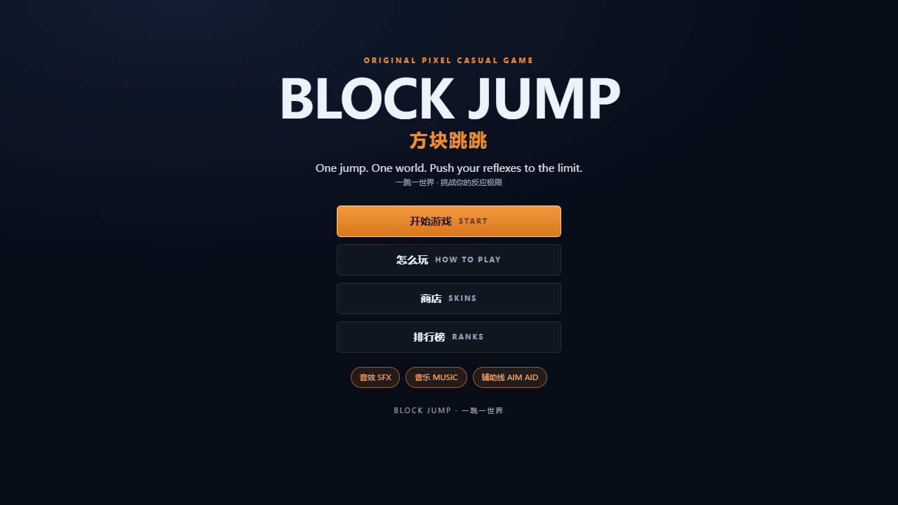
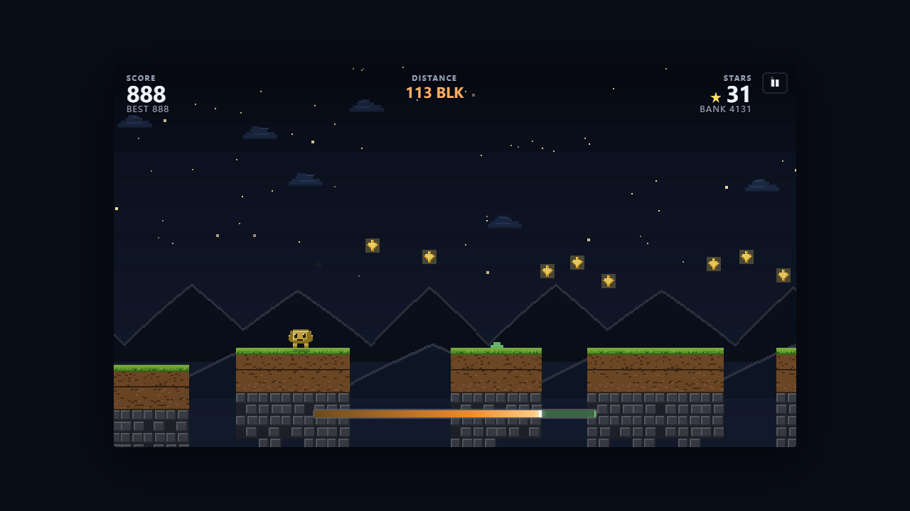

# 方块跳跳 Block Jump

一键操作的像素风休闲跳跃游戏 —— 把设计稿（`方块跳跳 Block Jump.pdf`）里的玩法、美术方向和六个章节的内容做成了一个真正能玩的东西。

打开 `index.html` 就能玩：没有构建步骤、没有依赖、不联网、没有二进制素材（像素美术和音效全部由代码生成）。




上图都是端到端测试跑出来的实机截图（`tests/browser.js` 会自动生成到 `preview/shots/`）。

想发给朋友玩，或者上线成一个链接（手机上直接打开就能玩），见 **[deploy/DEPLOY.md](deploy/DEPLOY.md)**：附带 `Dockerfile` + `deploy/nginx.conf` + `deploy/sealos.yaml`，可以直接部署到 [Sealos](https://sealos.run/)（应用启动台：镜像 + 端口 80，其余留空）。

懒得折腾容器的话，先跑 `node deploy/build-single-file.js`：它会产出一个 `dist/block-jump.html`，CSS / 十个脚本 / 图标全部内联，**整站就这一个文件**，不发出任何额外请求 —— 传到任意静态托管就是一个网址，直接发文件给朋友也能打开就玩。

这个目录可以直接 `git init` 成仓库推到 GitHub：仓库里带了 GitHub Pages 的用法和 `.github/workflows/docker.yml`（推上去就自动构建镜像，本机不用装 Docker），细节见 [deploy/DEPLOY.md](deploy/DEPLOY.md) 的"推到 GitHub"一节。

## 玩法 / How to play

按住 → 蓄力；松开 → 起跳。跳上一个又一个悬浮平台，吃掉星星，别掉下去，也别撞上旋转的刺球。

| 操作 | 键位 |
| --- | --- |
| 蓄力 / 起跳 | `空格` / `W` / `↑` / 鼠标左键 / 触屏点按（按住蓄力，松手出跳） |
| 暂停 | `Esc` / `P` |
| 开始 / 重开 | `Enter` |

循环很短：落地 → 按住蓄力 → 松手。起跳角度固定 64°，起跳位置就是**你落下的地方**，所以唯一的决策就是蓄力大小。

- 落到哪里就从哪里起跳，落地位置本身就是策略：站在平台越靠右，到下一个平台的横向距离越近；贴着右侧边缘落下判定 PERFECT，+50 分。
- 每一跳都保证有解 —— 生成器按"方块可能站着的每一个位置"逐个验证（4px 一格），所以从平台最左端到最右端，任何一处落地都能跳出去。

- 蓄力槽到顶后会自己回落（0→1→0 循环）。一直按住不会浪费：可以等移动平台靠过来，再在合适的力度上出手。
- 蓄力槽上的绿色区间是"这一跳能安全落上去"的力度范围；蓄力时画面上的虚线弧线是落点预览（辅助线，可在设置里关掉）。
- 星星既是分数，也是商店货币：每局结束自动存进银行。
- 道具：**护盾**（抵挡一次失误或坠落，最多叠到 2 个）、**加速**（8 秒内跳得更远）、**磁铁**（8 秒内自动吸附附近星星）。
- 平台类型：普通、移动（左右往返，需要等时机）、会塌（落地后约 1 秒碎裂，必须赶紧跳走）。
- 每 40 个平台切换一次场景主题：夜空 → 黄昏 → 紫晶洞窟，天空渐变会平滑过渡。

一局大约 30 秒到 3 分钟，和设计稿里写的一致（约每 1.1 秒过一个平台）。

## 已实现的功能

| 设计稿章节 | 落地情况 |
| --- | --- |
| 01 游戏介绍 | 一键像素跳跃；PC + 手机都能玩 |
| 02 核心玩法 | 跳跃 / 躲避 / 收集三步循环，落地即成 |
| 03 特色 | 一键操作、程序化关卡、本机排行榜、皮肤商店 |
| 04 操作 | 空格 / 鼠标 / 触屏，按住蓄力、松开起跳 |
| 05 难度曲线 | 平台变窄、间距变大、陷阱变密（终盘约 1/4 的跳跃带陷阱），但**从任何落点都有解**（见下） |
| 06 收集 | 星星 = 分数 + 货币；护盾 / 加速 / 磁铁三种道具 |
| — 额外 | 标题界面是 AI 自动演示（attract mode）、8 款皮肤、三种场景、芯片音效与循环音乐、屏幕震动和粒子反馈 |

## 为什么每一跳都一定有解

这是整个项目里最花心思的部分。起跳点固定、角度固定，所以一条跳跃弧线只由蓄力值决定，可以写成**闭式解**——并且这个闭式解是逐帧积分器（先更新速度再更新位置，含终端速度截断）的精确形式，不是连续时间的近似。因此生成器、瞄准辅助线和 AI 演示用的是同一个公式，预测的落点和真实物理落在同一像素、同一帧上。

关卡是逐个"长"出来的。因为方块**落在哪就从哪起跳**，一次跳跃是否公平，取决于它落在平台上的位置：同一个缺口，站在最左边要跳满力，站在最右边只要轻点。所以验证不是"从边缘能不能跳过去"，而是"**从这个平台上每一个可能站着的位置**能不能跳过去"：

1. 把落点位置从平台最左到最右按 4px 逐一取样（96px 宽的平台上就是 23 个位置），每个位置都要求存在一条可行弧线；
2. 每条弧线要落在下一个平台内（左右各留 2.5px 余量），且不会撞上更高平台的侧壁；
3. 对每个障碍，把弧线与障碍的**摆动包络**做最小距离检查（保守判定，与相位无关，另留 4px 采样余量）；
4. 可行蓄力区间要够宽：最左端（最难的位置）空跳 ≥ 0.045、有障碍 ≥ 0.06、落点是移动平台 ≥ 0.11；其余位置也要 ≥ 0.045 —— 保证任何一处落地都还有舒服的一跳；
5. 移动平台额外要求"可跳时机"至少持续 0.2 秒，避免出现只能靠帧级别运气接住的组合，并在它的摆动范围内取四个相位分别验证；
6. 缺口大小会被**起跳平台的宽度**卡住：平台越宽，方块到自身右边缘的助跑越长，能跨的缺口就越小 —— 所以"宽平台配短缺口、窄平台配长缺口"，任何落点都够得着；
7. 障碍不会贴着任何一侧边缘生成，而且新加的障碍还要回头验证**上一跳**没有被它破坏；
8. 生成时用"粗筛 + 精验"两段式：先用三个关键位置快速筛掉不可能的摆法（所以可以试十几种障碍摆位），通过的再按 4px 全量确认；
9. 连试 12 种布局仍不可解时，退化到"短、宽、无陷阱"的安全平台——永远留一线生机。

星星是按照"舒适蓄力"的弧线摆的，所以它们天然落在你能跳到的路径上。

## 验证

三个脚本（Node 20+，无需安装依赖）：

```bash
node tests/sim.js      # 核心逻辑：调参合理性 + 关卡可解性 + AI 用真实物理跑通关
node tests/bench.js    # 性能：每平台生成耗时、求解器耗时
node tests/browser.js  # 端到端：真实浏览器里加载页面、操纵菜单、手动跳跃、AI 连跳、结算
node tests/deploy-check.js   # 部署文件：Dockerfile 的 COPY 路径、页面引用是否都在镜像里、K8s YAML 一致性
node tests/http-smoke.js     # 用静态服务器像容器那样托管，再用浏览器验证（含刷新后进度是否保留）
node tests/single-file.js    # 单文件版：先重新构建，再验证它不发出任何子请求、本地和 HTTP 下都能玩
```

`deploy-check.js` 和 `http-smoke.js` 不需要 Docker，只用一个 Node 和一个本机浏览器就能跑；`http-smoke.js` 还可以指定任意目录：`node tests/http-smoke.js <解压出来的目录>`。

`tests/sim.js` 当前结果（10 局 × 220 个平台）：

```
40 seeds x 150 platforms: 6000 jumps, 1498 hazards, 603 movers, 649 crumbles
ok  no unsolvable jump :: 0 of 6000
ok  every jump keeps a fair charge window :: min 0.056
ok  moving platforms are catchable for long enough :: min 1.870s
ok  solvable from every standing position :: 0 of 118040 offsets unsolvable (2px 取样，比生成器更细)
ok  gaps stay inside the reachable range :: 127.8 <= 156.9
ok  avg gap: start 43.5px, mid 63.8px, late 74.1px
ok  bot never dies :: 0 deaths            (10 局 2200 次落地)
ok  block never slides on its own after landing :: 0 self-moves
ok  block never hangs off a platform edge :: 0 frames
ok  stars are collectable :: 4316 stars
```

第 4 项最关键：机器人用的是**和游戏完全相同的物理与输入通道**（`Player.botInput`，也正是标题界面的演示 AI），它把每一跳都当作一次真实的按键来做，所以求解器和真实物理之间只要有一点偏差，它就会掉下去。它不掉，说明这套"保证有解"的推导是对的。

`tests/browser.js` 用 Playwright + 本机 Edge 跑真实页面（路径写死在文件顶部，换机器需要改 `EDGE`）。14 项检查：控制台零报错、标题/玩法/商店/排行榜/暂停/结算都能渲染、买皮肤会扣星星并写入存档、键盘按"看力度条松手"的方式真能连跳、AI 连跳 10 秒稳定推进、模拟时间和真实时间 1:1、**落地后不再自己移动**、护盾真的能救回一次坠落、结算会写进排行榜。截图输出在 `preview/shots/`。

## 目录结构

```
index.html          页面骨架 + 六个界面（DOM 菜单，画布只画游戏世界）
css/style.css       设计稿的配色与排版：深蓝底、单一橙色强调、粗体无衬线 + 表格数字
js/config.js        物理常数、经济数值、皮肤与场景调色板、跳跃数学（闭式解）
js/world.js         程序化关卡生成 + 可解性求解器（纯逻辑）
js/player.js        状态机与物理；botInput 是演示/测试共用的 AI（纯逻辑）
js/pixel.js         程序化像素美术：角色、地块、星星、陷阱、道具、云、山
js/render.js        画布渲染：视差背景、岛屿、特效、瞄准弧线
js/audio.js         WebAudio 芯片音效 + 循环音乐（无音频文件）
js/ui.js            DOM 界面：HUD、菜单、商店、排行榜
js/input.js         空格 / 鼠标 / 触屏 → 一个"按住"状态
js/save.js          localStorage 存档（纯函数 normalize 可测）
js/game.js          主循环、相机、局内生命周期、把上面这些接起来
Dockerfile          整站打包成 nginx 镜像（Sealos / 任意 k8s 都能跑）
deploy/             nginx 配置、Sealos/K8s YAML、构建脚本（镜像 / 单文件）、部署说明、图标生成器
dist/               单文件构建产物 block-jump.html（一个文件就是整站）
favicon.png 等       站点图标与 manifest.json（同一个像素角色，浏览器标签页和手机桌面图标）
tests/              上述六个验证脚本
preview/shots/      端到端测试产出的截图
```

## 调参

难度手感几乎都在 `js/config.js`：

- `phys.gravity` / `v0Min` / `v0Max` / `angle`：跳跃弧线的形状（改完记得跑 `tests/sim.js`，最大跳跃距离会随 `v0Max²` 变化）
- `phys.chargeTime`：蓄满所需秒数
- `world.gapMinEasy` / `gapMaxEasy` / `gapMinHard` / `gapMaxHard`：间距成长曲线
- `world.rampFrom` / `rampLength`：从第几个平台开始变难、多少个平台后到顶
- `phys.walkSpeed` 已经没有了：方块落地后不会自己挪位置，落点就是起跳点
- `world.windowMin` / `windowPlainMin` / `windowMoverMin`：留多宽的容错窗口（越大越友好，也直接决定陷阱和移动平台能被接受的比例）
- `economy`：分数与完美落地奖励；`skins`：皮肤与价格

改完记得跑 `tests/sim.js`：那 11 项检查（尤其是"从每个落点都有解"和"机器人不掉下去"）就是防止改坏这套保证的。生成一个平台现在约 9ms，游戏里每 6 帧最多生成一个、始终保持领先 3 个平台，所以不会卡帧。

内置分辨率是 480×270，按整数倍（大屏）或最大等比（手机）缩放并居中留黑边，所以像素永远是硬的。`C.view` 可以改，但 HUD 是 480×270 的等比盒子，改了要一起调 CSS。

## 没有包含的部分

- **全球排行榜**：设计稿里的 "Compete worldwide" 需要服务端。本地榜单已完整实现；要接服务端，在 `js/game.js` 的 `finishRun()` 里把 `BJ.Save.insertScore(...)` 的结果同时 POST 给你的接口，并把 `js/ui.js` 的 `refreshRanks()` 换成拉取远端数据即可（`profile.scores` 的结构就是渲染契约）。这里没有留下无法运行的网络代码。
- 账号、云存档、成就、广告位、埋点。
- 手柄支持（现在的输入层只抽象了一个"按住"，接手柄只需要在 `js/input.js` 里多挂一个事件源）。

## 运行环境

Chrome / Edge / Safari / Firefox 的近几年版本都可以。直接双击 `index.html`（`file://`）即可，本地存档在 `file://` 下同样可用；如果浏览器对本地存储有限制，游戏会照常运行，只是不保存记录。手机端建议横屏。
